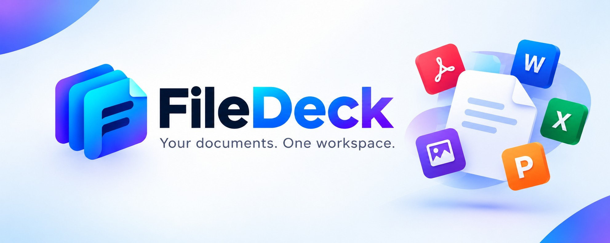
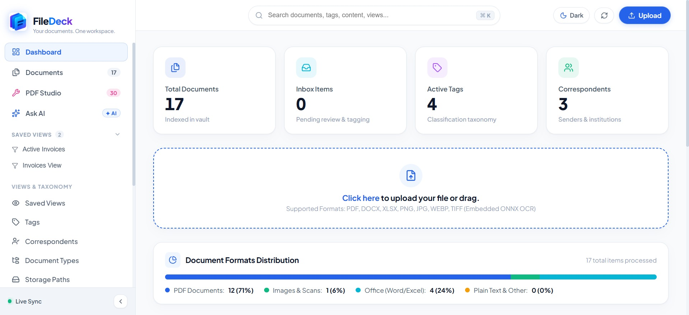
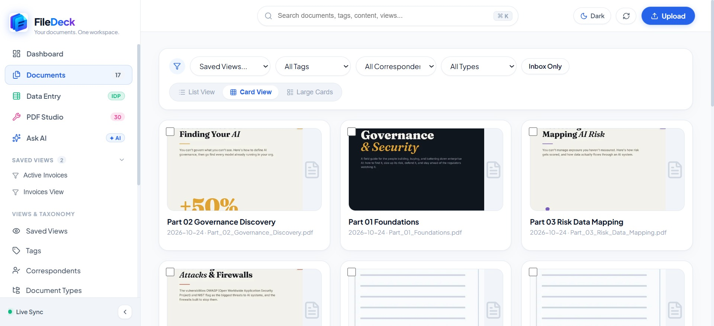
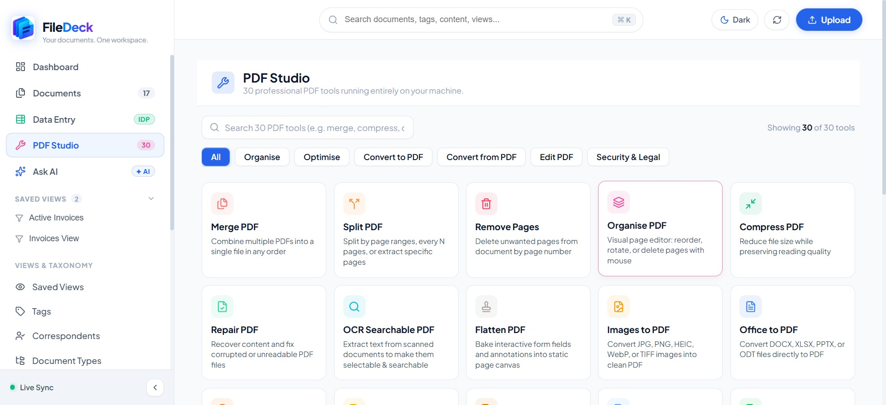
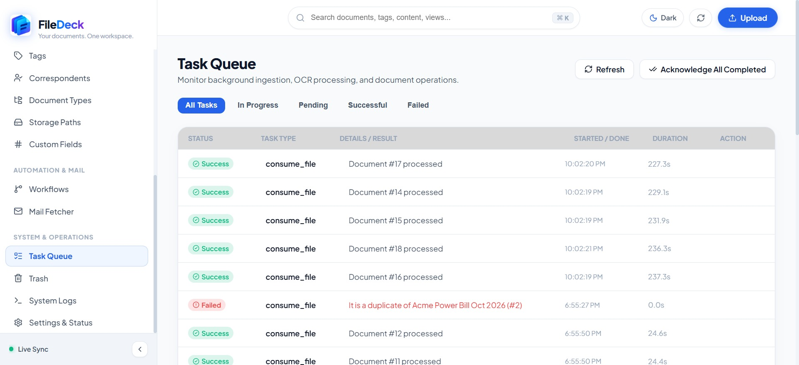
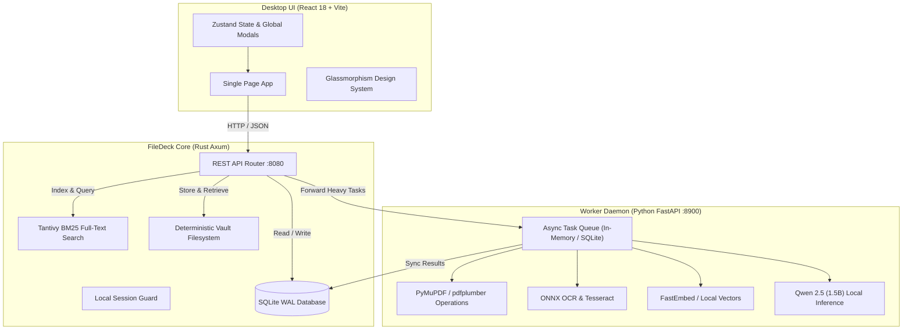

<p align="center">
  
</p>

<div align="center">
  <h1>FileDeck</h1>
  <p><sub><em>Your documents. One workspace.</em></sub></p>
</div>

<p align="center">
  <a href="#architecture"></a>
  <a href="#features"></a>
  <a href="#pdf-studio"></a>
  <a href="#desktop-app"></a>
  <a href="#stack"></a>
</p>

<p align="center">
  
  
  
  
  
</p>

---

## Description

**FileDeck** is a fast, 100% offline document workspace that keeps all your files organized, searchable, and completely private on your own computer. Whether you are managing bills, receipts, contracts, tax records, or research decks, FileDeck automatically reads text from scans and images, organizes your paperwork with smart tags and senders, and lets you find anything in seconds with instant search. It also comes with an all-in-one studio of **30 handy PDF tools** that let you merge, split, compress, protect, watermark, and convert documents right on your machine with zero internet required.

---

## Overview

Modern document apps often make you choose between privacy and convenience: online PDF tools upload your sensitive files to third-party web servers, while regular desktop folders cannot automatically read scans, extract text, or organize paperwork.

**FileDeck solves this:**
- **Zero Cloud Uploads**: All processing (text recognition, search indexing, PDF tools) runs strictly on your computer. Your files never leave your machine.
- **Lightning Fast**: A lightweight native core provides instantaneous search and folder navigation without lag or loading spinners.
- **Complete File Lifecycle & Organization**: Keep full version history, custom notes, neat folder templates, and a 30-day safety trash bin so you never lose important files.
- **Comfortable Modern Interface**: Clean, responsive layout with dark and light themes, smooth interactions, and thoughtful in-app confirmation modals.

> 🖥️ **Native Offline Desktop App (Tauri In Progress)**  
> FileDeck is crafted from the ground up to be a true local-first desktop application. Standalone, installable desktop packages (`.msi` for Windows, `.dmg` for macOS, and `.AppImage` for Linux) powered by **Tauri** are actively in development to deliver a single-click native desktop experience without requiring manual service setup.

---

## Core Features

### 1. Document Management & Multi-Format Ingestion
- **Multi-Format Ingestion**: Ingest PDF, Word (`.docx`), Excel (`.xlsx`), PowerPoint (`.pptx`), TIFF, PNG, JPG, and Markdown.
- **Smart Duplicate Prevention**: Automatic SHA-256 content hashing detects duplicate files and links them to the existing document record.
- **3 Flexible View Modes**: Browse documents via responsive Table View, Card Grid View, or Large Preview Cards.
- **Faceted Filtering**: Filter instantly by correspondent, document type, tag combinations, date ranges, or custom metadata fields.
- **Configurable Saved Views**: Create, save, and pin customized filtered queries directly into the primary navigation sidebar.
- **Bulk Operations**: In-app bulk edit, tag assignment, multi-file re-OCR, version merging, and batch ZIP export.

### 2. 30-in-1 Native PDF Studio
A dedicated offline workstation built directly into FileDeck with zero cloud upload limits or subscription gates:

| Category | Available Tools |
| :--- | :--- |
| **Organise & Structure** | **Merge PDF**, **Split PDF**, **Remove Pages**, **Organise PDF**, **Crop PDF**, **Flatten PDF** |
| **Optimise & Repair** | **Compress PDF**, **Repair PDF**, **OCR Searchable PDF**, **Rotate PDF** |
| **Convert To PDF** | **Images to PDF** (JPG, PNG, HEIC, TIFF, WebP), **Office to PDF** (DOCX, XLSX, PPTX), **HTML to PDF** |
| **Convert From PDF** | **PDF to Images** (PNG/JPG ZIP), **Extract Images**, **PDF to Word** (`.docx`), **PDF to Excel** (`.xlsx`), **PDF to PPTX**, **PDF to Markdown**, **PDF to Text** |
| **Security & Legal** | **Protect PDF** (AES password encryption), **Unlock PDF**, **Redact PDF** (permanent blackout), **Sign PDF** (digital/visual stamp), **PDF to PDF/A** (long-term preservation) |
| **Edit & Annotate** | **Watermark PDF** (text/image with custom opacity and angles), **Page Numbers** (custom positions & formats), **Edit PDF**, **Compare PDF** (diff side-by-side), **PDF Metadata** (title, author, subject) |

### 3. Local Search & AI Intelligence
- **Tantivy Full-Text Search**: In-memory BM25 index over all document OCR text, titles, correspondents, and tags with instantaneous results.
- **Offline AI Assistant ("Ask AI")**: Powered by a local Qwen 2.5 (1.5B Instruct) model running directly on your CPU. Ask natural language questions about your documents without internet access.
- **Vector Embeddings**: Local BGE embedding model for semantic similarity clustering and related document suggestions with offline hash fallback.

### 4. Interactive Document Drawer & Version Control
- **Document Detail Drawer**: Inline PDF viewer, full document metadata editor, and searchable text inspector.
- **Revision History**: Upload new revisions, track document versions, and roll back or download any previous version.
- **Archive Serial Number (ASN)**: Automatic sequential barcode and physical filing number generator.
- **Notes Timeline**: Add timestamped private notes and annotations directly to any document record.

### 5. Taxonomy & Custom Metadata Engine
- **Tags**: Color-coded taxonomy labels for organizing documents across projects and categories.
- **Correspondents**: Track senders, recipients, and institutions associated with incoming documents.
- **Document Types**: Classify documents into structured types (Invoices, Receipts, Bank Statements, Contracts).
- **Dynamic Storage Paths**: Rule-based directory formatter (`{created_year}/{correspondent}/{title}`) with simulated breadcrumb previews.
- **Custom Metadata Fields**: Define custom data fields across 8 types (Text, URL, Date, Boolean, Integer, Float, Monetary, and DocumentLink).

### 6. Workflow Automations & Mail Fetcher
- **Workflow Automation Engine**: Trigger automated actions (tag assignment, correspondent tagging, title formatting, storage path assignment) on document ingestion.
- **IMAP/POP3 Mail Fetcher**: Periodically scans configured email accounts, extracts PDF attachments, and ingests them directly into your inbox.

### 7. Operations, Task Queue & 30-Day Trash Bin
- **Live Task Queue**: Monitor background ingestion, OCR progress, task duration, retry failed jobs, and acknowledge completions.
- **30-Day Safety Trash**: Soft-delete safety net holding deleted items for 30 days with one-click restore and permanent purge safeguards.
- **Audit Logs Viewer**: Full operational trace viewer for backend diagnostics, watcher events, and system activities.

### 8. UI Experience & Unified In-App Modals
- **100% In-App Modals**: Completely replaces native browser alert, confirm, and prompt dialogs with accessible, themed modals featuring backdrop blur, keyboard navigation (<kbd>Enter</kbd> / <kbd>Esc</kbd>), and destructive action safeguards.
- **Fast Theme Switching**: Instant toggling between modern Dark Mode and clean Light Mode.
- **Keyboard Shortcuts**: Quick search access via <kbd>Cmd</kbd>/<kbd>Ctrl</kbd> + <kbd>K</kbd>.

---

## Current Snapshots

| **Intuitive Analytics Dashboard** | **Rich Document Vault & Card Explorer** |
| :---: | :---: |
| <a href="public/dashboard.jpg"></a> | <a href="public/documents.jpg"></a> |
| *Real-time vault statistics, ingestion status, document format distribution, and inbox alerts.* | *Instant faceted filtering, saved views, multi-card grid, and batch operations.* |
| **30-in-1 Offline PDF Studio** | **Real-Time Asynchronous Task Queue** |
| <a href="public/pdf_studio.jpg"></a> | <a href="public/task_queue.jpg"></a> |
| *Full suite of 30 local PDF tools organized 5 per row with zero external cloud dependencies.* | *Live job tracking, OCR progress, version merge status, and duplicate detection.* |

---

## System Architecture



---

## Tech Stack

| Layer | Technologies |
| :--- | :--- |
| **Core Backend** | **Rust**, **Axum**, **Tokio**, **SQLx**, **Tantivy** (Full-text engine), **Chrono**, **SHA-256** |
| **Worker Engine** | **Python 3.12**, **FastAPI**, **PyMuPDF (fitz)**, **pdfplumber**, **pikepdf**, **Pillow**, **ONNX Runtime** |
| **Database** | **SQLite 3** running in Write-Ahead-Logging (WAL) mode for high-throughput concurrent transactions |
| **Frontend UI** | **React 18**, **TypeScript**, **Vite**, **Zustand**, **TanStack Query (React Query)**, **Lucide Icons** |
| **Styling** | **Custom Vanilla CSS Design System** with CSS variables, backdrop blur glass panels, and zero Tailwind bloat |
| **In-App AI** | **Qwen 2.5 (1.5B Instruct GGUF)** local model, **BGE-small-en** embeddings, **RapidOCR** |

---

## Repository Structure

```text
FileDeck/
├── backend/                  # High-performance Rust Axum Core
│   ├── src/
│   │   ├── ingest/           # Multi-format document parser & file watcher
│   │   ├── routes/           # REST API routes (documents, tags, views, PDF studio)
│   │   ├── search/           # Tantivy BM25 full-text indexing engine
│   │   ├── workflows/        # Automated rule evaluation engine
│   │   └── main.rs           # Server lifecycle & Axum entrypoint
│   ├── migrations/           # SQLite schema migrations
│   └── Cargo.toml            # Rust dependencies & build settings
├── worker/                   # Local Python Processing Engine (FastAPI)
│   ├── app/
│   │   ├── routers/          # AI chat completions & model endpoints
│   │   ├── routes/           # PDF Studio operational router
│   │   ├── services/
│   │   │   ├── ocr.py        # Embedded RapidOCR (ONNX) & Tesseract pipeline
│   │   │   ├── pdf_ops.py    # 30 native offline PDF manipulation tools
│   │   │   ├── pdf_env.py    # System engine discovery (Ghostscript, LibreOffice)
│   │   │   ├── models.py     # Qwen 2.5 (1.5B) GGUF download & streaming manager
│   │   │   └── embeddings.py # Local FastEmbed & hash vectorizer
│   │   └── main.py           # Worker daemon entrypoint (:8900)
│   └── pyproject.toml        # Worker dependencies & Python environment
├── frontend/                 # Reactive Desktop UI (React 18 + Vite + TypeScript)
│   ├── src/
│   │   ├── api/              # Unified API client & React Query hooks
│   │   ├── components/       # Reusable UI components & GlobalModal dialog
│   │   ├── pages/            # Views (Dashboard, Documents, PDF Studio, Ask AI, etc.)
│   │   ├── store/            # Zustand global state (filters, theme, modal store)
│   │   ├── index.css         # Glassmorphism design system & CSS tokens
│   │   └── App.tsx           # Application root & hash routing
│   └── vite.config.ts        # Vite bundling configuration
├── public/                   # Branding assets & application snapshots
├── filedeck.toml             # Default application configuration
├── .env.example              # Environment variables template
└── .gitignore                # Git exclusions (build artifacts, vault, AI weights)
```

---

## Quickstart & Installation

### Prerequisites
- **Rust**: `1.78+` (via [rustup.rs](https://rustup.rs))
- **Python**: `3.11+` or `3.12+` (with `uv` or `pip`)
- **Node.js**: `18+` or `20+` (with `npm`)

### 1. Clone Repository
```bash
git clone https://github.com/samolubukun/Filedeck.git
cd Filedeck
```

### 2. Configure Environment
Copy the example configuration:
```bash
cp .env.example .env
```
Default configuration values in `filedeck.toml` and `.env`:
- **Backend Port**: `8080`
- **Worker Port**: `8900`
- **Vault Directory**: `./vault`
- **Database File**: `./vault/filedeck.db`

### 3. Start Python Worker
```bash
cd worker
# Using uv (recommended)
uv venv
uv pip install -r requirements.txt
uv run uvicorn app.main:app --host 127.0.0.1 --port 8900 --reload
```

### 4. Build Frontend
```bash
cd ../frontend
npm install
npm run build
```

### 5. Launch FileDeck Rust Backend
```bash
cd ../backend
cargo run --release
```

Once running, navigate to:
```
http://localhost:8080
```

---

## Environment Variables

| Variable | Default | Purpose |
| :--- | :--- | :--- |
| `FILEDECK_HOST` | `127.0.0.1` | Local IP to bind backend server |
| `FILEDECK_PORT` | `8080` | Port for the web interface and REST API |
| `FILEDECK_DATA_DIR` | `./vault` | Storage path for ingested documents & indices |
| `FILEDECK_WORKER_URL` | `http://127.0.0.1:8900` | Address of the background Python worker |
| `FILEDECK_MAX_UPLOAD_MB` | `500` | Max file upload size in megabytes |
| `FILEDECK_OCR_LANGUAGE` | `eng` | Default OCR language recognition code |

---

## Verification & Automated Testing

FileDeck includes an automated test suite verifying search indexing, taxonomy matching, workflows, and ingestion:

```bash
# Run backend Rust test suite
cargo test --manifest-path backend/Cargo.toml
```

---

## Privacy & Security Guarantee

FileDeck was built around the principle of **strict privacy**:
- **Zero Outbound Telemetry**: FileDeck never phones home, sends usage metrics, or pings third-party analytics.
- **Air-Gapped Friendly**: Functions 100% offline without any internet connection.
- **Direct File Ownership**: Your documents remain standard PDF and Office files stored in your local vault folder, never locked into proprietary binary formats.

---

## License

This project is distributed under the **MIT License**. See [LICENSE](LICENSE) for details.
